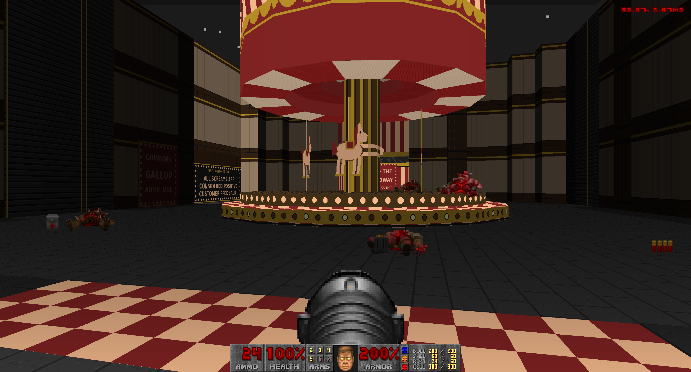
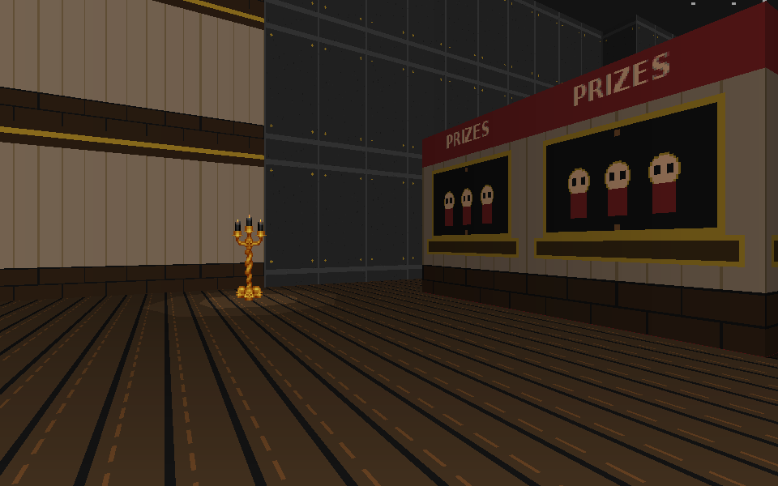

# Graveyard Shift

An original spooky carnival DOOM mapset with cheerful rides, corporate satire,
and a metal arrangement of a sinister park jingle. Built for [GD-DOOM](https://github.com/Distortions81/GD-DOOM).

**Maps 1 and 2 are playable.** Map 1 — Admission Is Mandatory — has ticket booths, animated fountain
water, a short staff-area loop and a circular carousel with wooden horses and
monsters. “All screams are considered positive customer feedback.”



## Play

The ready-to-load `graveyard-shift.wad` includes **E1M1 and E1M2**. It targets GD-DOOM
with the DOOM shareware IWAD (`DOOM1.WAD`), using classic DOOM formats and actions;
no Boom features or scripts are required. Supply your own IWAD and engine.
This repository contains no base-game graphics, sounds, sprites or IWAD.

With a GD-DOOM binary installed as `gddoom`:

```bash
./play.sh --iwad /path/to/DOOM1.WAD -width=1920 -height=1080 -detail-level=0 -skill=3
```

The launcher defaults to modern mode. To use a particular executable:

```bash
GD_DOOM_BIN=/absolute/path/to/gddoom ./play.sh --iwad /absolute/path/to/DOOM1.WAD
```

Alternatively, load the IWAD and add-on in GD-DOOM's browser build and start
Episode 1. Original DOOM restricts add-ons with the shareware IWAD; GD-DOOM
supports this combination. For other IWADs, rebuild the texture tables with
`--iwad`. Other engines have not been exhaustively tested.

Map 1 now exits into Map 2. Map 2 currently exits into the IWAD’s E1M3. Maps 3–4
remain planned. First-visit completion time and combat balance need human playtesting.

## Map 2 — Midway Massacre

The midway adds a shooting gallery with a shootable prize target, rigged booths,
eight rounded bumper cars and a prize-redemption finale. Two token gates form a
loop back through the midway. Normal doors keep the opening fight from pulling
in the entire gallery and service court.

It has **50.9% more reachable floor area** than Map 1, measured on the shared
64-unit design grid with doors open: 1,842 cells versus 1,221. HMP has **54 enemies**
and three secrets; Easy has 34 enemies and UV has 60. Size, not enemy density,
is the primary increase. Bumper cars are detailed static cover, without vehicle controls.

```bash
./play.sh --iwad /path/to/DOOM1.WAD -map E1M2 -skill=3 -width=1920 -height=1080
# Recorded HMP run, all kills and secrets:
./playtests/watch.sh attempt-02-midway --iwad /path/to/DOOM1.WAD
```



The latest pass adds small sprite-light pools, outdoor moon shadows and
texture-sized prize booths. Full-size door posters and signs have been checked
for clipped words, including the relocated Next Shift sign.

See [Map 2 design and playtest notes](MAP02.md) for the route, validation and
lessons carried over from the opener.

## Explore the files

- `graveyard-shift.wad`: the current playable map, original graphics and music.
- `assets/textures/`: editable PNG source art, including signs and animated frames.
- `assets/admission-jingle.json`: lyrics, notes, rhythm and chord progression.
- `assets/admission-waltz.mus`: current metal score; the filename is historical.
- `previews/`: engine screenshots, map overview, texture atlas and audio previews.
- `build.py`: shared geometry, art, music and classic WAD builder.
- `midway.py`: Map 2 geometry, encounters and original midway art.
- `lighting.py`: Map 1 sprite-light placement, floor-light polygons and moon-shadow brushes.
- `map-manifest.json` / `map02-manifest.json`: per-map counts, actions, secrets, landmarks and floor-area comparison.
- `playtests/`: pinned historical WADs, demos, numeric controls and verification results.

The current music is a 26-second loop in 3/4 at 112 BPM. Its distorted lead follows
an imaginary seven-syllable lyric, backed by power-chord chugs, picked bass and
drums. The lyrics guide the instrumental melody; there are no embedded vocals.
`previews/admission-metal.wav` is the current arrangement;
`previews/admission-jingle.wav` preserves the earlier park-jingle version.

Outdoor skies stay high above the playable spaces. Map 1 adds decorative sprite lights,
small sector-light pools and architectural moon shadows; see [lighting and surface notes](LIGHTING.md).
Signs use ordinary wall faces and texture
offsets, without overlaid sign walls. Chasing lights and rippling water use the
classic `GSTFONT`, `SLADRIP` and `FWATER` animation ranges at eight tics per frame.

## Route and balance

Find the security shotgun, cross the staff yard, climb to the control booth,
collect the blue pass and restore admission power. Return via the balcony,
open the gate and clear the carousel courtyard on your way to the midway.

| Difficulty | Enemies |
| --- | ---: |
| Easy (skills 1–2) | 20 |
| Hurt Me Plenty | 36 |
| Ultra-Violence / Nightmare | 52 |

Three optional secrets contain armor, supplies and a chaingun. The main route
provides a shotgun and ammunition. Four co-op and four deathmatch starts exist;
multiplayer balance has not been playtested.

## Episode pacing

The episode has **four maps**. Map 1 is cute, short and sweet: a welcoming ticket
plaza, a glimpse behind the cheerful facade, and one open circular carousel with
wooden horses and monsters beneath its striped canopy. Its existing route and
enemy counts stay small; added detail improves composition rather than length.

Each later map introduces a different part of the park and grows in size and
playtime. These are design targets, not measured times; Maps 1–2 are built; Maps 3–4 are not built yet.

| Map | Theme and reserved attractions | First-visit target |
| --- | --- | --- |
| 1 — Admission Is Mandatory | Tickets, fountain, carousel; “Your fun is mandatory.” | 3–5 minutes |
| 2 — Midway Massacre | Shooting gallery, rigged prize booths, bumper cars; impossible performance quotas | 6–9 minutes |
| 3 — Tunnel of Loathe | Ghost train, funhouse, tunnel ride; a compulsory corporate team-building excursion | 10–14 minutes |
| 4 — The Happiest Place in Hell | Roller coaster, Ferris wheel, backstage power plant and executive finale | 15–20 minutes |

Save those later attractions for their own reveals. Map 1 should establish the
park’s friendly colors, eerie after-hours atmosphere and petty corporate cruelty
without showing everything the episode has to offer.

## Demos and verification

```bash
./playtests/watch.sh --iwad /path/to/DOOM1.WAD
```

The default demo completes an earlier detailed Map 1 revision in 2:38.40 with
36/36 kills and 3/3 secrets, using weighted turns and running. It includes a
cleared-carousel tour. Each recording uses its matching pinned WAD: the latest
sky and sign fixes are in the main WAD and are not retroactively added to demos.

The current map passed GD-DOOM collision/progression checks on three skills,
secret-door and texture checks, and reference render checks in Chocolate Doom.
The historical demo replayed exactly in GD-DOOM and independently completed in
Chocolate Doom. See [playtest notes](playtests/README.md) for scope and results.
Numeric aiming assistance makes these tool-assisted runs, not human benchmarks.
The engine-specific test harness remains in the GD-DOOM development workspace.

## Rebuild

Requires Python 3, Pillow, DejaVu Sans Bold and [ZDBSP](https://github.com/rheit/zdbsp).
The generated WAD uses normal classic nodes, not extended/compressed nodes.

```bash
python3 -m pip install -r requirements.txt
python3 build.py --iwad /path/to/DOOM1.WAD
# Preserve edited PNGs:
python3 build.py --iwad /path/to/DOOM1.WAD --keep-art
# Explicit node-builder path:
python3 build.py --iwad /path/to/DOOM1.WAD --node-builder /path/to/zdbsp --keep-art
```

The IWAD is read to build compatible texture and palette metadata; its graphics,
sprites and sounds are not copied into the generated add-on. Rebuilding replaces
the WAD and generated previews. Back up hand edits or use `--keep-art`.

## License

The original map, generator, graphics and music are licensed under GPL-2.0;
see [LICENSE](LICENSE). DOOM and its base-game assets belong to their respective
owners and are not included here.
